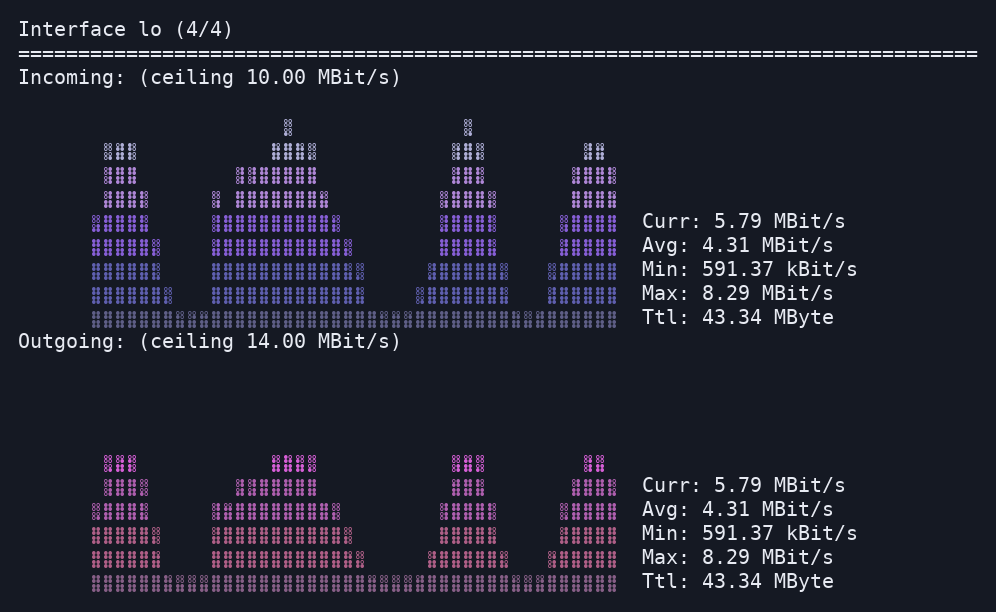

# nload-rs

Watch live incoming and outgoing network traffic on Linux with Braille graphs
and per-interface statistics.



*The loopback interface (`lo`) under local test traffic, with `--color` enabled.*

## Install

Download `nload-rs-linux-x86_64.tar.gz` and its `.sha256` file from
[GitHub Releases](https://github.com/CodeWithMa/nload-rs/releases).

```sh
sha256sum -c nload-rs-linux-x86_64.tar.gz.sha256 &&
  tar -xzf nload-rs-linux-x86_64.tar.gz
```

Run `./nload-rs` from the extraction directory, or move it onto your `PATH`.

## Quick start

Press the arrow keys to switch interfaces and `q` to quit. The graphs use your
terminal’s foreground color by default. To enable color and start on `lo`, run
this from the extraction directory:

```sh
./nload-rs --color lo
```

If `nload-rs` is on your `PATH`, run:

```sh
nload-rs --color lo
```

Replace `lo` with the interface you want to watch. If it isn’t present at
startup, nload-rs starts on the first available interface and switches to the
requested one when it first appears. New interfaces become available as they
appear; disconnected interfaces stay in the list and are marked unavailable.

Use `-i VALUE` and `-o VALUE` to set the incoming and outgoing graph ceilings.
Both default to 10,240 kBit/s (10 MBit/s in binary units). Run
`nload-rs --help` for all options.

Use a terminal at least 60×16 with UTF-8 and a font that renders Braille.
`TERM` must be nonempty and neither `dumb` nor `linux`. `--color` requires
256-color support and takes precedence over `NO_COLOR`.

## Build from source

Use this checkout or extract `nload-rs-source.tar.gz` from
[GitHub Releases](https://github.com/CodeWithMa/nload-rs/releases). The release
archive includes the locked dependencies and can be built offline. From the
source directory, with stable Rust that supports edition 2024:

```sh
cargo install --path . --locked
```

### Arch Linux package

Build the `x86_64` package from this checkout using the
[PKGBUILD](packaging/arch/PKGBUILD):

```sh
sudo pacman -S --needed base-devel rust
cd packaging/arch
makepkg -si
nload-rs
```

Run `makepkg` as your normal user. If you already have stable Rust and Cargo
through Rustup, you can skip installing the `rust` package.

## Development

```sh
cargo fmt --check
cargo test --locked
```

The tests require access to `/proc` and the ability to allocate a
pseudoterminal (PTY).

To cut a release, push a `v` tag matching the version in `Cargo.toml` (for
example, `v0.1.4` for version `0.1.4`). The Linux workflow runs the tests,
checks the release binary, and publishes the binary archive, its checksum, and
the corresponding source archive.

## Credits and license

Inspired by [nload](https://github.com/rolandriegel/nload) by Roland Riegel,
with graph styling inspired by [btop](https://github.com/aristocratos/btop).

Licensed under [GPL-2.0-only](LICENSE). See
[third-party notices](THIRD-PARTY-NOTICES.md) for dependency licenses.
